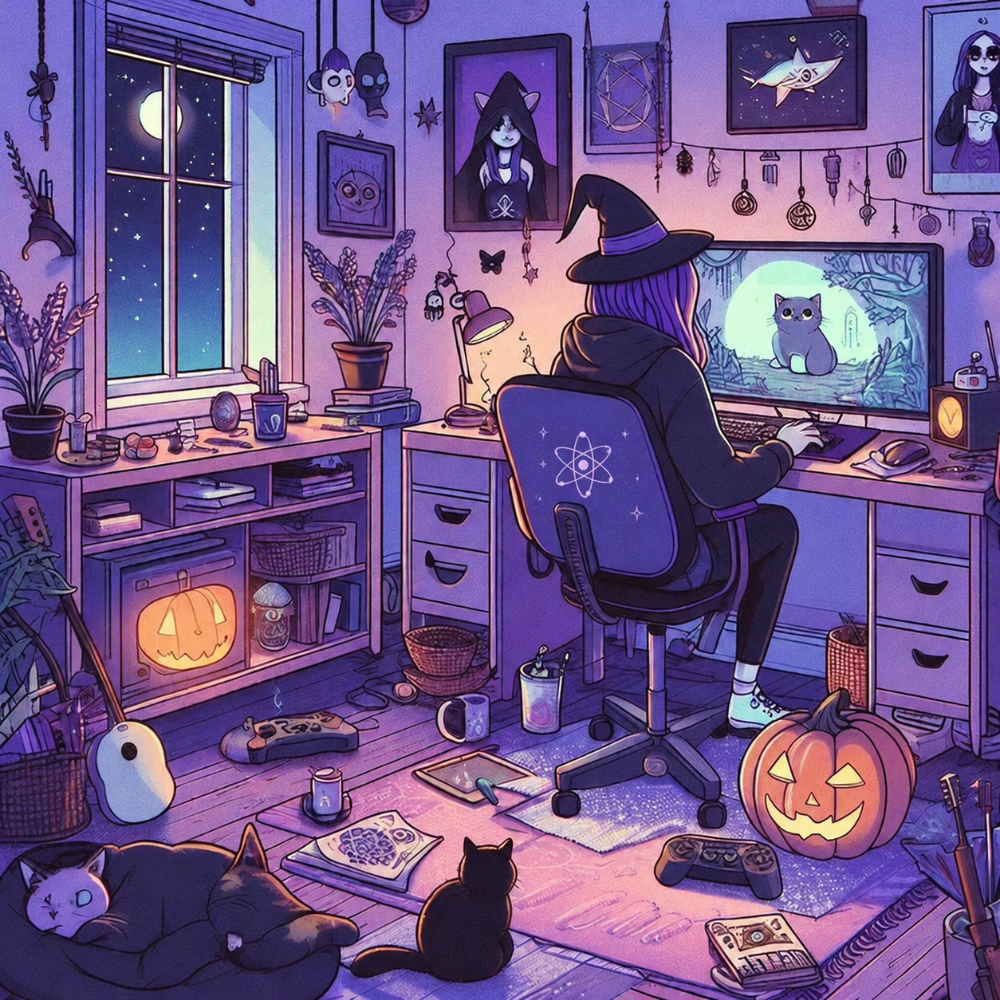

# 🧩👾 puzzleGame

A 5×5 image puzzle game built with plain HTML, CSS and JavaScript. No frameworks, no installation: just open it in your browser and play.

**▶️ [Play it here](https://yelle-stack.github.io/puzzleGame/)**

## How to play

- The picture is cut into 25 pieces and shuffled.
- Click two pieces to swap them, or drag one piece onto another.
- Put every piece back in its place to win. The counters at the top show your moves and how many pieces are correctly placed.

## Features

- 25-piece puzzle (5×5 grid)
- **Choose your own photo**: click the **My photo** button to load any image from your phone or computer, and the puzzle reshuffles with it (the image is cropped to a square)
- **Preview** button to see the completed picture
- **Shuffle** button to start a new game
- Works on desktop and mobile, with light and dark mode support
- Default picture is a sunset landscape drawn with JavaScript canvas

## Run it locally

1. Download or clone this repository.
2. Open `index.html` in your browser.

That's it, everything is in a single file.

## Customize

To change the number of pieces, edit `const N=5` in the script, then update `repeat(5,1fr)` and `background-size:500% 500%` in the CSS to match (for example `4` and `400%` for a 4×4 puzzle).

## Built with

HTML, CSS and vanilla JavaScript.
