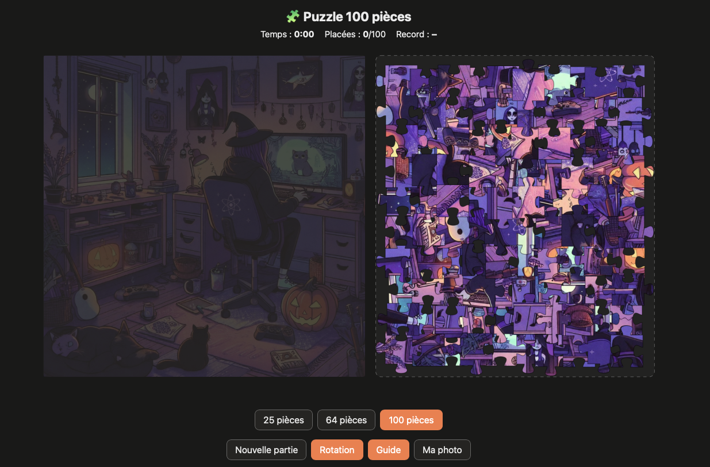

# 🧩👾 puzzleGame

A jigsaw puzzle game with up to 100 interlocking pieces, built with plain HTML, CSS, JavaScript and SVG. No frameworks, no installation: just open it in your browser and play.

**▶️ [Play it here](https://yelle-stack.github.io/puzzleGame/)**

## How to play

- The picture is cut into realistic pieces with tabs and slots, then scattered next to the board, each one turned in a random direction.
- Drag a piece onto the board to place it.
- Tap a piece without moving it to rotate it by 90°.
- When a piece is in the right spot and facing the right way, it snaps into place and locks.
- Place every piece to win. The timer and the counter at the top show your progress.

## Features

- **Three sizes**: 25, 64 or 100 pieces
- **Realistic piece shapes** drawn with SVG, different in every new game
- **Rotation mode**: pieces start rotated and must be turned. Turn it off with the **Rotation** button for an easier game
- **Choose your own photo**: click **My photo** to load any image from your phone or computer. It is cropped to a square and cut into pieces
- **Guide** button to show or hide a faint image of the finished puzzle on the board
- **Timer and best time**: your record is saved in your browser, separately for each size and mode
- Works on desktop and mobile (touch or mouse), with light and dark mode support
- Default picture is a sunset landscape drawn with JavaScript canvas

## Run it locally

1. Download or clone this repository.
2. Open `index.html` in your browser.

That's it, everything is in a single file.

## Customize

- **Default size**: change `let n=10` at the top of the script (the number of pieces per row and column).
- **Available sizes**: edit the list `[[5,'25'],[8,'64'],[10,'100']]` near the end of the script.
- **Snap distance**: the `.35` in `Math.hypot(p.x-X,p.y-Y)>c*.35` controls how close a piece must be to snap into place (a higher value makes the game easier).
- **Colors**: edit the CSS variables at the top of the stylesheet (`--accent`, `--bg`, etc.).

## Built with

HTML, CSS, vanilla JavaScript and SVG.
